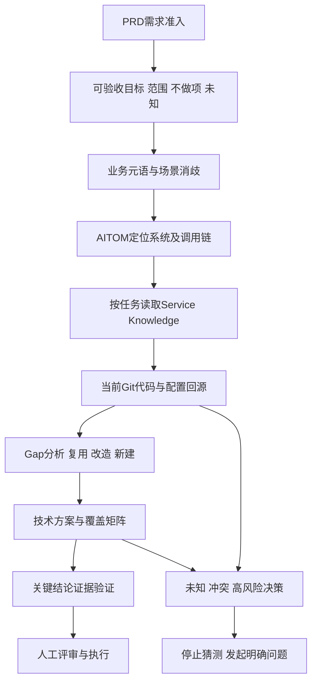

# 架构师Agent系统化落地

## TL;DR

复杂存量系统的问题不是 AI 不会写代码，而是业务意图、跨服务链路、历史兼容和工程红线散落在不同来源，导致“局部正确、整体错误”。本文以技术方案设计为切入口，先完成需求准入，再以结构化领域知识、架构图谱、服务知识和代码回源组织渐进式调研。知识库负责认知骨架，RAG 负责发现与补证，Harness 负责上下文、工具、停止条件和验证闭环。作者报告“体验站三期”案例的技术方案覆盖度超过 95%，前提是原始需求完整度较高、知识体系完备，并保留人工评审与关键决策职责；这不等于任何需求都可以无人确认。（来源：p.1–5、p.19–21）

## 为什么旧城比白纸困难

**架构师 Agent**在本文中的目标，是理解复杂系统，并依据真实业务、架构和工程事实完成判断；当前已落地的具体职能是技术方案设计。新系统可以新建模块、接口和边界，而存量系统必须遵守未必直接写在代码里的约束：一个 MQ 消息只能新增字段不能改变语义，一段看似冗余的代码可能兼容旧客户端，新增同步调用可能消耗核心链路的超时预算。编译和单测通过无法证明这些跨系统约束仍成立。

作者把必需知识分为四类。业务知识负责消歧：“订单”可能指交易订单、支付单、配送单或对账单；架构知识负责服务职责、请求路径、一致性边界与数据主责；服务内部知识负责 API、状态机、缓存、消息、配置、定时任务和测试；工程组织知识负责重试、限流、灰度、回滚、安全与监控。知识缺口会直接改变方案落点，AI 编码速度又会放大错误传播，所以先把方案方向确定下来具有更高价值。（来源：p.2–4）

## 主线：从需求到证据充分的方案

下图按正文 p.14–19 整理。各节点代表认知与验证阶段，不表示预先加载全部资料。

## 知识库先对齐领域，再选择检索方式

### 强结构提供“知识覆盖约束”

**固定结构知识库**的作用，是告诉 Agent 完成一个业务判断至少需要理解哪些方面。RAG 找出语义可能相关的资料，却不能天然保证知识集合完整：完整方案、会议纪要、接口说明和复盘截图的颗粒度不同；“订单取消”的相似文字不一定包含状态机禁止跳转、历史消费者或接口调用权等真正决定正确性的约束。Top K 又可能混合不同时间与范围的资料，让上下文变长而证据结构变弱。

因此，本文主张先建立领域骨架，再以 RAG 扩充长尾资料与证据。业务结构包含 `meta`（业务元语）、`principle`（一致性、幂等、超时、兼容等原则）、`scenario`（业务动作映射到 API、服务、消息、数据、异常和补偿）、`practice`（历史决策、事故及兼容原因）、`reference`（其他领域关系与契约）、`history`（历史记录）。阅读顺序先消歧，再定位场景，遇到约束回到原则，追查原因再读实践。

这种结构既不是把全部 Wiki 换一种目录摆放，也不是取消检索。结构化知识负责核心事实，图谱负责寻址和链路分析，服务知识负责约束与验证，RAG 负责发现与补证；缺口从原资料获得确认后，再回写结构化知识。`business-knowledge-distill` 在文中用于从技术方案、稳定性串讲和交互图中蒸馏业务知识，示例展示了高德实时公交知识库目录，但没有提供完整 Skill 定义或脚本。（来源：p.6–10）

### 知识维护必须进入研发流程

知识过期后仍显得可信，比简单缺文档更容易误导 Agent。服务知识可与 Git Push、Pull Request 和发布联动：Hook/CI 从 Diff 识别受影响的 API、数据库、消息、配置和测试，生成更新候选并检查结构、链接、版本基线与必填字段。对 API 契约、数据库语义、MQ Schema、状态机、安全策略和历史兼容等高风险内容，自动化负责发现变化、阻止遗漏，人工负责确认语义；不能把每次代码变更直接自动覆盖成业务事实。

业务知识还需要两种节奏：日常随关键 API、业务链路和规则变化做增量维护；周期性利用大促前后稳定性梳理、系统串讲与事故复盘校准跨系统历史知识。重要知识最好附来源、最后确认时间、适用范围、当前状态和负责人，方案关键结论也应能回源。（来源：p.10–11）

### Service Knowledge 不只是代码摘要

**Service Knowledge**在本文中描述服务职责与边界、领域对象、API/事件契约、数据模型和依赖。它可以与代码同仓，也可以通过 Runtime、Harness 或 Skill 在本地关联；同仓并非必要条件。首次生成重在覆盖，增量生成可关联 Git Hook 或 Coding Agent Hook。作者强调其结构来自 DDD、边界和安全方法论，并认为 YAML 比 Markdown 具有更强结构与信息密度；这是作者的设计判断，不是本文提供的跨格式对照实验。

服务知识的收益有三层：快速索引代码结构；避免每次任务重新提取实体与逻辑；在跨多微服务任务中减少把全部源码塞入有限上下文而触发有损压缩。作者提到代码超过 5 万行时遍历差异会很大，并称 code graph 类方式一般至少提升 25% 效率，但未给具体实验设置、样本或指标定义，这个数字不能当作通用保证。（来源：p.11–12）

## 渐进式披露与回源：让下一步由缺口触发

**渐进式披露（Progressive Disclosure）**要求每一步只加载当前判断所需的知识。业务层回答为什么改、需求语义如何对应系统/API；架构层回答涉及谁与影响谁；系统层回答服务怎样安全修改；基建层提供工程底线。作者给出的迭代频率分别为低、中、高、很低，表达的是层级维护差异，不是固定调度周期。

路径先从 PRD 词语解析到业务对象和状态，再从业务场景进入同步调用、异步消息及补偿链路，随后借助 AITOM 看清上下游、协议和超时，最后进入目标仓库读取短入口 `AGENTS.md` 与 `.knowledge/`，核对实际代码、配置和 Git 基线。仓库入口负责路由，不应变成新的长篇 README。

不同事实要回到不同来源：当前生产行为以代码和配置为准，业务意图以已确认产品与业务知识为准，历史原因以可追溯实践为准。当前实现不自动等于未来正确业务规则，旧文档也不能压过当前代码。案例中知识库写某模块“不排序”，而代码实际统一按权重排序，设计据此修正并登记知识回写；`entrance` 仓也曾因业务关键词 grep 未命中而被误排除，沿通用规则引擎继续追踪才发现需要扩展。两例说明检索未命中与“无需改动”之间没有直接等号。（来源：p.12–13）

## 技术方案设计：输入、Gap、输出和停止条件

### PRD 准入是输入转换器

**`prd-digest`**用于需求准入，不代替详细技术设计。它检查用户、情境、问题、替代方式障碍、准备改变的行为和成功指标，并审查价值依据、范围、能力复用、验收与可逆性。未知应被明确标记，不能替产品编造事实。输出是包含可验收目标、范围、不做项、关键假设、阻断项、待确认问题和专项评审触发项的需求包。

作者还讨论“需求增强”的职责归属：研发更能判断技术现状，产品拥有改需求权，因此不能简单宣布某方独占。由架构师 Agent 扩展承担这一环节是作者展望，不能当作本文已经验证的独立落地结果。（来源：p.14–15）

### 六步形成可执行方案

1. 读准入后的需求包，提取目标、边界、风险和待确认信息。
2. 用业务知识解析元语与场景，确认需求究竟指什么。
3. 用架构图谱定位候选服务和完整链路，检查主路、旁路、同步/异步、服务等级及红线。
4. 按变更类型读取服务知识，再核对当前代码与配置。新增 API 关注契约、兼容、测试和政策；数据库变更关注表语义、迁移和下游依赖。
5. 做 **Gap 分析**：语义一致的已有能力复用；需要扩展的说明改造边界；确认不存在的才新建。判断不能只依据“看见类似代码”。
6. 输出改动点、调用方影响、异常传播、兼容策略、测试矩阵、发布/配置动作、需求覆盖矩阵、知识库联动与待确认项，并验证关键结论。（来源：p.16–19）

Runtime 在任务推进中反复“发现问题→判断缺什么→定位来源→按需加载→更新上下文→继续推理”。本文的“纯 AI 做方案”指调研、检索、链路推理、代码核查、文档生成与覆盖检查可由 AI 独立完成；业务取舍、跨团队接口承诺、数据口径、合规和高风险授权出现时，应停止猜测并请求人类裁决。Skill 固化稳定流程与边界，Harness 组织上下文、工具、停止条件和验证，基础模型承担推理规划与动态编排。（来源：p.17–18）

### 可执行性不是“写得通顺”

方案必须明确必改仓库、只读系统和范围外参与方；给出 PRD/业务/配置/服务/代码术语映射；解释复用、改造、新建的理由；分析调用者、异常传播与必须保持的存量行为。验证按变更类型展开：API 做契约，状态机做核心流程，消息做生产者/消费者兼容，缓存看失效和降级，灰度与配置检查开关关闭后的存量回归。未知与冲突保留在待确认列表。

作者用五问检查每条需求：改哪里、为什么改、影响谁、如何验证、还有什么没有确认。覆盖度拆为需求、系统、证据、风险、验证、不确定性治理六维。案例的 95% 以上依赖需求准入、知识回源、代码配置核查和人工评审；剩余往往属于人类决策权限，而不是继续让模型猜出的“最后 5%”。（来源：p.18–19）

## 数据与边界速查

| 指标 | 原文数值 | 语境 / 条件 | 出处 |
| --- | --- | --- | --- |
| 方案完善度目标 | 95% 以上 | 团队设定目标；主要工程问题覆盖，不是线上全知 | p.19 |
| 案例方案覆盖度 | 95% 以上 | 体验站三期；原始需求较完整、知识体系完备、采用一流基模 | p.19 |
| 覆盖维度 | 6 个 | 需求、系统、证据、风险、验证、不确定性治理 | p.19 |
| 代码索引效率说法 | 至少提升 25% | 作者关于 code graph 类方式的概括，实验口径未给出 | p.11 |
| 大代码库举例 | 超过 5 万行 | 说明遍历成本；非统一性能阈值 | p.11 |

## 可迁移的设计原则与记忆锚点

- 先建立认知骨架，再补长尾检索：适用于需要完整工程判断的复杂系统，不否认开放式检索价值。
- 保留事实来源差异：实现事实、业务意图和历史原因不能相互替代。
- 自动化发现漂移，人工确认高风险语义：更新知识不等于自动授权规则改变。
- **助记改写**：“元语找准、链路找全、代码回源、五问验收”。这是对本文流程的凝练，不是作者原话。

## 复习卡片

复杂存量系统中“局部正确、整体错误”为什么单测未必能发现？::错误可能落在服务职责、跨服务超时、消息语义和历史兼容层面，局部实现正确仍会破坏整体约束。（p.2）
固定结构知识库与RAG怎样分工？::前者规定必须理解的核心事实与阅读路径，后者用于长尾发现和证据补充，确认后回写结构化知识。（p.10）
为什么关键词grep未命中不能证明仓库无需改动？::业务词可能不等于代码术语；需沿场景和架构图谱确认真实职责与依赖，entrance案例说明了这种漏项。（p.13）
不同事实应该向哪些来源回源？::当前行为查代码配置，业务意图查已确认产品和业务知识，历史原因查可追溯实践。（p.13）
prd-digest的输出应包含什么？::可验收目标、范围、不做项、假设、阻断项、待确认问题和专项评审触发项，并保留未知。（p.14）
Gap分析为什么不能直接改成文件列表？::它必须解释复用、扩展或新建的语义依据和边界，强迫方案回答为什么这样做。（p.16、18）
架构师Agent遇到什么条件应停止猜测？::业务取舍、跨团队承诺、数据口径、合规及高风险授权需明确问题并交由人类裁决。（p.18）
案例95%以上覆盖度有哪些前提？::较完整的准入需求、完备知识体系、关键事实回源、代码配置核查与人工评审；不代表任何需求无需人确认。（p.19）

## 知识关联

- 研发与上下文：[[AI研发协同]]、[[Harness与模型协同]]、[[Agent工程循环]]。
- 知识与治理：[[决策知识结构化]]、[[Agent长期记忆]]、[[问题澄清]]。
- 结果验证：[[Agent评测与反馈]]。

## 原文参考资料

原文列出 [Spec Kit](https://github.com/github/spec-kit/blob/main/docs/index.md)、[Kiro Specs](https://kiro.dev/docs/web/specs/)、[Kiro Best Practices](https://kiro.dev/docs/specs/best-practices/)、[Anthropic长程Harness](https://www.anthropic.com/engineering/effective-harnesses-for-long-running-agents)、[OpenAI Harness engineering](https://openai.com/index/harness-engineering/)；还引用《分解一座冰山：后端系统“AI知识库体系”建设实践》和《后端架构 AI Friendly 的标准与路径》。这些为原文资料，未访问核验。（p.21）

本次归纳主题：[AI研发协同](../../20_topics/AI研发协同.md) · [Harness与模型协同](../../20_topics/Harness与模型协同.md) · [决策知识结构化](../../20_topics/决策知识结构化.md) · [问题澄清](../../20_topics/问题澄清.md)。

> [!note]- 校对报告
> **覆盖度**：通读 p.1–23 全部文字，浏览全部页图缩略，放大核对 p.1,6,13,17,19。主要章节已覆盖；文末营销、推荐与读者留言未作为技术结论。
> **一致性**：
> 
> | 核对项 | 笔记值 | 原文值与位置 | 结果 |
> | --- | --- | --- | --- |
> | 完善度目标 | 95%以上 | 95%以上，p.19 | 一致 |
> | 覆盖维度 | 6个 | 六个维度，p.19 | 一致 |
> | 效率概括 | 至少25% | 至少提升25%，p.11 | 一致 |
> | 代码规模举例 | 超过5万行 | 超过5万行，p.11 | 一致 |
> | 需求验收检查 | 五问 | 五个问题，p.19 | 一致 |
> 
> **推断与异常**：p.21参考资料列表未见正文引用的[8]条目；不补齐该引用。
> **日期与格式**：发布日期取自 p.1 页首，2026-08-27，未推测时区。归档沿用本库 `AI_短标题.md` 命名。一个 H1、卡片单行 `问题::答案`；Mermaid 未渲染，文章代码/命令未执行。
