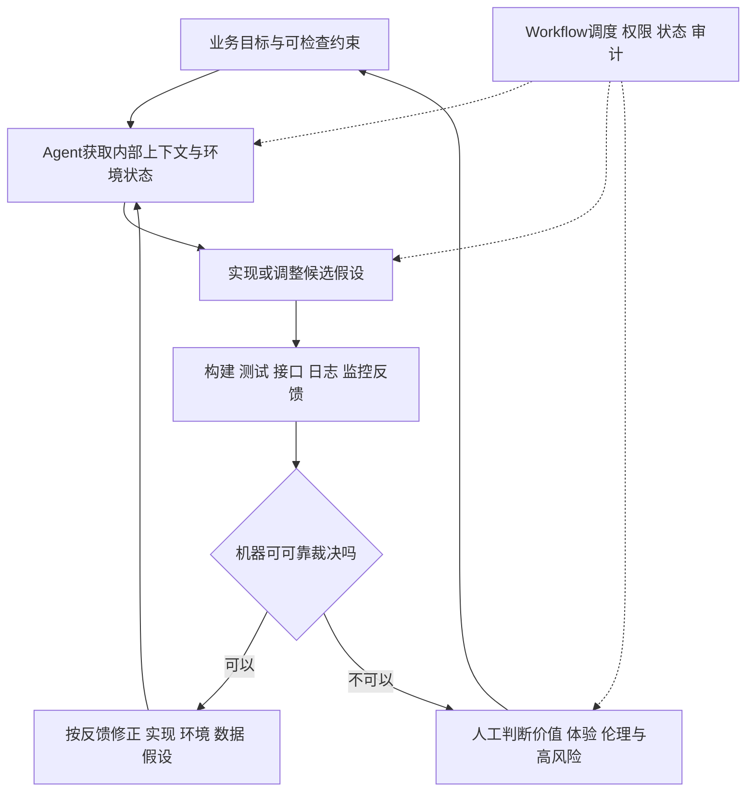

# 环境与验证驱动AI研发

## TL;DR

作者认为模型生码能力的快速上涨，并没有同步转化为企业端到端交付效率，因为构建、数据、联调、跨平台发布、灰度和合规等环节仍缺乏可调用环境与反馈。把每个人工流程节点换成 AI 有现实价值，但固定阶段人工验收会限制自主循环。本文提出让 Agent 自主获得验证信号，把 workflow 主要用于调度、权限、状态保存、审计和高风险检查。长期投资应优先建设模型无法自行生成的内部真实状态与验证设施；这是作者个人判断与案例经验，不是公司立场或已受控验证的普遍规律。（来源：p.1–7）

## 高分Coding为何不等于快速交付

文章列 2026 年 7 月模型 benchmark 快照，但提醒各来源口径不同：有官方自报、公开对照、修正版任务集、OpenHands、厂商与独立测试等区别。因此排行榜只用于说明编码能力正在提升，不能跨模型把所有百分数直接排序，不能把 benchmark 成功等同于生产系统工作完成。

作者自己的 C 端动线需求，改码与本地验证约 1 小时，线上生效却因多个内部平台关联发布与 618 封网耗时 3 周。例子把瓶颈从“代码写得多快”转到“改动如何真正生效”。团队粗略统计生码仅占研发链路 20%–30%，甚至更低；原文借阿姆达尔定律说明只优化局部的提升上限。这里“占三成环节压近零，链路提升上限三成”宜按总耗时最多减少该占比理解，不能无口径地写成吞吐加速 30%。案例 1 小时/3 周与团队粗估占比是不同样本，不能拼成统一比例。（来源：p.1–3）

## 可验证反馈是作者诊断的核心

**可验证反馈**指能够让机器判断候选行为是否符合预期的信号，例如编译、测试、接口调用、日志和监控。作者认为 Coding 与数学优先被突破，与公开语料及规模化验证有关；企业环境的答案却藏在内部系统，反馈不公开且验证昂贵。相应工程任务是把内部工作流改造成“有反馈、可验证”的环境。

本文借 Jack Reeves《Code as Design》的“源代码才是软件真正设计，文档只是摘要”观点强调：文字方案不等价于实现结果。业务意图需要成为精确、可运行的表达，并被验证符合预期；仅让 AI 更会生成文本与代码，不足以绕过环境和交付的缺口。这是作者解释路径，不是对所有研发任务的归因证明。（来源：p.3）

## 从固定节点到自主反馈循环

### 原有路线的收益与天花板

**Workflow化**在文中代表 PRD→需求澄清→技术方案→任务拆解→生码→测试，各节点用 AI 提效，节点验收和流转按原有人工流程。作者将 SDD、Skills、Superpowers 等归入这类路线，并认可现实价值；问题是它优化“人怎样使用 AI”，却未充分改造“AI 怎样使用环境”。

真实失败来源可能位于实现、环境、数据、架构假设或需求理解。若测试失败一律退回方案再生码，会把已经正确的判断一起推倒；固定阶段又容易默认澄清后需求正确、评审后方案可行。机制上的改造不是取消任何流程，而是让验证信号有足够细的定位，使 Agent 能沿失败来源修正。（来源：p.4–5）

### Agentic的本文定义

**Agentic**在此被定义为 AI 能否自主获得验证信号，而非 AI 独占决策权。Workflow 保留调度、权限控制、状态保存、审计与高风险检查；人工主要处理机器无法可靠裁决的业务价值、用户体验和伦理边界。图与正文均把自动验证和必要人工判断分开，不能把它读成“任何阶段不准人工参与”。（来源：p.5–6）

下图按正文 p.4–7 整理，仅表示反馈循环与控制边界，没有新增固定实施顺序：

## 电气化类比：换动力与重构生产系统

作者用工厂电气化说明“新技术套进旧结构”的局限。早期厂房围绕一台动力机、传动轴和皮带布局，将蒸汽机换为大电机后，能源变了但布局和组织仍旧，局部故障、联动和损耗问题仍在。资本存量、改造投资、停产成本、电网覆盖及标准不成熟，都让迁移很慢。

单元驱动给每台机器独立电机，布局才可按原料、加工、装配和输出重排，支持流水线与更灵活搬运。作者认为真正收益来自生产系统互补改造，而不仅是动力转换效率；将其类比到 Agent，就是让 Coding 工位能独立调用环境和验证，不再每步依赖中央人工传动。历史类比帮助解释观点，不能当作 AI 收益曲线的实验依据。（来源：p.3–5）

## 投资判断：下一代模型会让它获益还是作废

作者的判断题是：**“下一代 SOTA 模型发布时，我正在做的这件事，是获益，还是作废？”**

| 投入类型 | 本文举例 | 作者判断的机制 | 出处 |
| --- | --- | --- | --- |
| 补偿生成/推理能力 | 微调提升生码、提示词技巧、精细步骤编排 | 模型升级可能把脚手架能力内化 | p.5 |
| 提供模型造不出的信息 | 内部构建、部署、数据、接口、日志、监控、发布工具 | 更强模型仍需真实环境，可运行更深的循环 | p.5–6 |
| 必要模型接入 | 模型选型、评测、上下文接入 | 作者明确仍需做，以同一判断题划界 | p.6 |

作者把企业 AI 红利类比为模型能力与环境能力的乘积：模型由厂商升级，环境需企业自建，缺一端就难形成生产力；模型变强会重新放大同套环境价值。**这是解释性关系，不是给出可测量变量、单位和拟合结果的定量公式。**图中 2024 与 2027+ 的价值占比表达趋势，尤其 2027+ 是前瞻设想，不用作已发生的时间分配统计。“环境只涨不跌”也属于作者主张，不意味着环境永远免维护、永不失效。（来源：p.6）

## 五项基础设施与Spec的新职责

1. **业务领域知识**：领域 Skill、本体知识库，让内部业务语义能进入上下文；文中没有提供可安装 Skill 全文。
2. **可复现可调用环境**：Agent 能构建项目、启动服务、准备数据、调用接口、操作浏览器/APP、看日志调用链与监控。这些是“只有人会操作的内部系统”向工具能力的翻译。
3. **分层验证**：秒级的编译、类型检查和单测支持高频迭代；分钟级的集成、契约与浏览器自动化覆盖真实行为；人工保留机器无法可靠裁决的价值、体验和伦理。
4. **研发系统端到端打通**：发布、实验、监控平台等改造为 AI Friendly，解决跨系统交接。
5. **区分约束与假设**：数据不可出域、接口向后兼容、延迟不得超阈值是长期约束，应保存并尽量自动检查；微服务还是单体、缓存策略等是可验证假设，允许依据实现和运行反馈调整。Spec 划定“什么算对”，不包办实现路径。（来源：p.6–7）

本文没有给沙箱部署、权限配置或验证平台的实现清单。可用于规划投资和验收边界，不能直接当成已经落地的环境搭建教程。

## 数据速查

| 指标 | 原文数值 | 语境 / 条件 | 出处 |
| --- | --- | --- | --- |
| 作者需求改码与本地验证 | 1小时 | C端动线改造案例 | p.2 |
| 编码完成至上线 | 3周 | 多内部平台关联发布与618封网 | p.2 |
| 生码占研发链路 | 20%–30%，可能更少 | 团队粗略统计，不是上述案例占比 | p.2 |
| 分层验证时延 | 秒级 / 分钟级 | 快速静态/单测 vs集成/契约/浏览器反馈 | p.6 |
| 历史电力比例 | 约5%→50% | 美国制造业1899→1919；作者历史类比 | p.4 |

## 记忆锚点与复习卡片

作者原句：**“关于世界的信息只能从世界里来，不可能从权重里长出来。”**（p.5）

为什么生码能力提升不等于交付效率同比提升？::编码只是链路一部分，环境、数据、联调、发布、灰度与合规仍可能占主耗时。（p.2–3）
本文Agentic核心定义是什么？::能自主获取验证信号，不是AI独占决策权；workflow仍承担调度权限状态审计和高风险检查。（p.5）
测试失败为什么不能一律退回方案重新生码？::失败可能来自实现、环境、数据、架构或需求理解，一律回退会推倒已经正确的判断。（p.4）
判断AI工程投资的核心问题是什么？::下一代SOTA发布时当前投入是获益还是作废，重点看它是补偿模型能力还是提供真实世界信息。（p.5）
Spec怎样区分约束与假设？::约束长期保存并自动检查，假设允许依运行反馈调整；Spec规定什么算对而不是唯一实现路径。（p.6–7）
模型能力×环境能力能当实测公式吗？::不能，本文是解释性类比，没有变量单位与实验拟合。（p.6）
人工应保留哪些裁决？::机器无法可靠判断的业务价值、用户体验、伦理以及高风险边界。（p.5–6）

## 知识关联

- [[AI研发协同]]、[[Harness与模型协同]]：环境工具化与模型分工。
- [[Agent评测与反馈]]、[[Agent工程循环]]：分层反馈与按失败来源调整。
- [[决策方法]]：投资是否随模型升级获益的判断题。

本次归纳主题：[AI研发协同](../../20_topics/AI研发协同.md) · [Harness与模型协同](../../20_topics/Harness与模型协同.md)。

> [!note]- 校对报告
> **覆盖度**：通读 p.1–9 全部文字，浏览全部页图缩略，放大核对 p.1,2,4,5,6,7。主要章节已覆盖；文末营销、推荐与读者留言未作为技术结论。
> **一致性**：
> 
> | 核对项 | 笔记值 | 原文值与位置 | 结果 |
> | --- | --- | --- | --- |
> | 改码 | 1小时 | 1个小时，p.2 | 一致 |
> | 上线 | 3周 | 3周，p.2 | 一致 |
> | 生码占比 | 20%–30% | 20%~30%，p.2 | 一致 |
> | 验证分层 | 秒级/分钟级 | 秒级/分钟级，p.6 | 一致 |
> | Spec分工 | 约束/假设 | 约束与假设，p.6–7 | 一致 |
> 
> **推断与异常**：p.1–2榜单为2026年7月多来源不同口径快照，未联网核验或作统一排名。；p.6趋势图2027+为前瞻示意，未当作已发生统计；“乘积”是作者解释性观点。
> **日期与格式**：发布日期取自 p.1 页首，2026-07-31，未推测时区。归档沿用本库 `AI_短标题.md` 命名。一个 H1、卡片单行 `问题::答案`；Mermaid 未渲染，文章代码/命令未执行。
