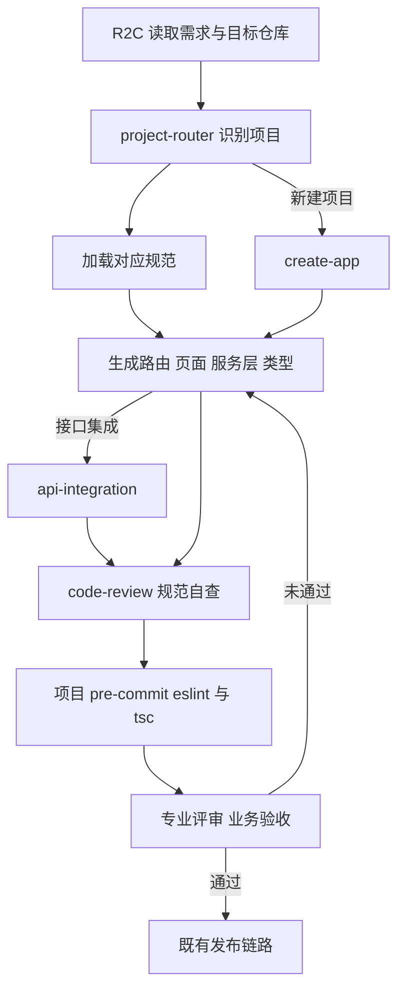

# 稳定性前端AI原生复盘

## TL;DR

稳定性前端团队发现，AI 让不同角色都能写代码，但技术栈、规范、交接和发布节奏没有自动统一，局部省时会变成下一环节的成本。实践以结构化 Skill 前置团队判断，再用 Anchor Plugin 打包工作流、规范、工具和执行门禁；设计原型与正式库分开，共享规范并按评审结果移植。PDFE 和 AI 全栈缩短部分交接，但保留专业 owner 的评审，复杂一致性、性能和维护问题仍需专家。团队已有上线与代码复用记录，返工、长期维护成本、应急助手诊断准确性和 MTTR 的改善尚缺稳定验证口径。（来源：p.1–14、21–22）

## 先看清“能运行”与“能接手”的距离

作者面对的是十几个中后台系统，已有鉴权、请求拦截、主题和组件约定。AI 的常见开源默认组合 Vite、Next.js、Tailwind、lucide-react，不能直接替代团队历史 Ice/Fusion、Umi/Ant Design、vite/xops 等体系。手写搜索框、按钮、图标造成重复组件；原型技术栈与正式开发脱节，则原型评审后仍需前端重做。（来源：p.1–2）

尝试过三条路径：基础课难传递特定仓库的长期经验；知识库在技术债未盘清时可能固化问题，缺 owner/review 会出现冲突，长 Prompt 还要每次重新交代；完整 R2C 平台需要配置接入、浏览器代理插件、自维护 API Key，长任务偶有中断。共同困难是规则进入实际代码生成的时机。团队最终选 **Skill（结构化规则包）**：集中维护、命中场景后加载到 AI 上下文，让使用者留在熟悉工具。（来源：p.2–3）

## Skill 先识别仓库，再给写法

第一步是仓库盘点，而非编写一套所有项目通用的规范。经典稳态使用 Ice.js 2.x、Fusion、React 16、Formily；稳定性标准体系以 `@alife/x-ops-*`、ProComponent 为主；通用新建用 React 18、Ant Design。UI、请求、表单、版本各有边界，不能混用。（来源：p.4）

`an-frontend-skill` 的五维结构是 **When / What / Don't & Why / How / Map**：涉及 React/TSX 生成、修改、重构、评审即进入；识别历史栈与新建场景；说明禁止项及理由；提供公共组件三段式、API 双轨、列表/表单骨架；按需关联设计 Token、国际化和项目专属规范。最小样板比抽象原则更接近交付要求，主 Skill 无需重写所有周边能力。（来源：p.4）

应用结果包括中等规模平台三天升级、AIOps 原型复用率提升、国际化六步幂等流水线、Status 健康看板上线。但 Skill 变细之后又出现装配遗漏：R2C 依赖设计规范、组件知识、部分 MCP，少一环仍能产出却悄悄偏离。Plugin 用统一安装与依赖配置处理这一层问题。（来源：p.5）

## Anchor 把组织层级与执行责任分开

**Anchor** 是团队前端 AI Coding 工作台，包含工作流层 `r2c/create-app/api-integration/project-router`，规范层 `coding-rules/goc-rules/xops-rules/design-system`，工具层 `alidocs/team-info/super-d2c`。Project-router 根据 git remote、`package.json` 与关键词识别归属，新建才调 create-app，接口集成才调 api-integration。（来源：p.6–7）

下面按正文及 p.7 原图整理，保留主线和条件加载关系，省略原图装饰。

执行门禁各负其责：项目 git pre-commit 自动跑 eslint+tsc；Plugin `/code-review` 在提 PR 前手动触发，先识别项目、读 git diff、加载规范；PreToolUse 在 AI 调 Bash 时拦 `npm install`、提示用 tnpm。另有 Hook 记录会话活跃度，原图说明“不上传会话内容”。不要把深度 Review 误写成每次提交自动执行。（来源：p.6–7）

六个 Skill、两个 MCP 的分别安装约十分钟，Plugin `install_from_path` 约三十秒；`.mcp.json` 提供安装引导，规范成为插件内单一事实源。这是作者环境下的安装记录，不是任何机器的安装保证。（来源：p.7）

## 两套代码怎样减少重复，而不制造发布冲突

最初让设计直接改正式仓库，试图取消视觉到代码的翻译。一周内出现 Tailwind、lucide-react、手写 SVG 与 xops/CSS Modules 冲突，内联 style、上千行单文件、大量 any 使审查困难。更关键的是设计面向未来多个迭代，前端只发当前 Sprint，人工拆发布范围的成本超过重做。（来源：p.8）

调整后 `aiops-studio` 原型库与 `an-aiops` 正式库物理隔离，frontend-skill 约束技术栈组件，design-skill 约束颜色间距等。设计走 MasterGo→D2C→原型库→AI 调整→部署评审→交付代码，前端走 Review→移植→微调。正式库只接收评审完成并适合当期的部分，共享规范但保留不同发布节奏。（来源：p.8–10）

过去两三天的还原/走查/修改压到半天，但钉钉卡片、复杂图表和精细动效仍难稳定生成，约20%继续设计出稿、前端实现；约80%走交付代码。**VersionShell** 进一步把各版本独立构建为 IIFE 包、发布 CDN、按需加载指定版本，使多个待评审原型互不覆盖，并能切回历史版本。（来源：p.9–10）

## PDFE、AI 全栈与专业责任

**PDFE（Product · Design · Frontend Engineer）**在本文指产品、设计、前端的复合角色。Agentic Ops POC 以1前端+4后端起步、没有 PD 和设计，作者承担从业务意图到界面的链路。例如应急时先展示结论、推理完成后折叠但可展开审查，是产品优先级、设计呈现和流式组件实现的共同判断；SSE 协议演进还要保持用户体验及渲染逻辑稳定。（来源：p.11–12）

团队全栈并非人人独立承担所有专业判断。标准页面由后端/PD借 R2C 实现，轻量后端逻辑可由前端借 AI 补位，但实现仍由对应 owner Review。p.13 原图保留“专业评审和业务验收→可交付？”分支，未通过返回实现，不能绕过验收直接发布。（来源：p.12–13）

跨端成本包括服务调用链/数据一致性需结对，陌生配置联调发布排障使排期不准，提交变多但 reviewer 时间没增加，生成者不长期维护时留下技术债。PDFE 适合探索期、专业角色暂缺且已有规范与业务积累；成熟版本、高视觉需求、复杂企业级场景仍需专业分工。CRUD/表单收益主要来自少等排期，中等前后端联动需结对评审，核心性能与一致性由专家主导。（来源：p.13–14）

## 团队能力沉淀的几个例子

**ai-drawio** 从 Prompt 模板到 Andraw Web App，再回到可进入既有 Qoder/千问办公会话的 Skill，避免单独算力与 API Key 运维成本。p.15 原图给出：画图需求、上下文、风格→识别图种/抽取元素/规划布局→生成 XML→结构校验→PNG 预览→交付 `.drawio`，预览不通过回到布局。图中节点与连线/样式是交付前检查的一部分；没有提供完整 Skill 脚本，不能据此安装。（来源：p.14–16 页图）

**q-sketch**把角色、色彩、Prompt 模板收成视觉规则，避免单篇及系列配图漂移；覆盖前端、后端、产品、设计、业务、测试六角色和暖橙、浅绿、暗夜暖金三主题。**ata-article**按读者/选题→大纲→事实正文→数据核对→配图→表达审查组织写作，并强调背景困难、关键动作、结果、反思，不用概念堆砌替代实践过程。原图给出规则摘要，未提供完整可安装 Skill。（来源：p.16–18）

两人在一周用 OneAgent、X-OPS ChatUI、AG-UI 做故障查询助手：ChatUI 提供会话骨架，OneAgent 编排，AG-UI 连接智能体与前端。p.18 原图中前端 Embed SDK 与 SSE/AG-UI 事件流交互，运行时 Agent Loop 调工具/MCP/Skill并返回事件，渲染 Markdown、Thinking、HTML。该组合成为后续业务默认脚手架，但这不等于诊断准确率已验证。（来源：p.18–19 页图）

前端小助手基于 AI Studio，集成钉钉、语雀、Aone、通知和文件工具，处理规范答疑、技术问题、项目进度及定时提醒。p.20 原图保留信息不足先追问，知识与工具取证，再组织结论、依据和下一步；项目进度明确时间范围。周五十点同步是文中系统功能，非本笔记创建了提醒。（来源：p.19–21）

## 数据与验证边界

| 指标 | 原文数值 | 语境 / 条件 | 出处 |
| --- | --- | --- | --- |
| 平台升级 | 23页、80多组件、30接口；3天 | Umi3/Ant Design Pro→Umi4/xops-design/ProComponents | p.5 |
| 原型复用率 | <30%→80% | 3页、24多组件、8接口；Skill+设计直接Coding | p.5 |
| 国际化周期 | 约2个月→2周 | 作者称相同工作量，六步五脚本幂等流程 | p.5 |
| Status看板 | 1页、10组件、9接口、3周；采纳80% | 已上线案例 | p.5 |
| 安装成本 | 约10分钟→30秒 | 6 Skill+2 MCP→Plugin统一装配 | p.7 |
| 原型库记录 | 104+ commits；前端34+设计50+后端20 | 2026.04起；4个版本 | p.10 |
| 正式库记录 | 399+ commits；双周迭代 | 2026.03.02起 | p.10 |
| AI使用快照 | 渗透100%、采纳79.6%、辅助代码1,216,288 | 稳定性团队2026.07，前后端等角色 | p.21 |
| 增量覆盖底线 | 行覆盖率稳定80%以上 | CIS单测与发布卡点 | p.22 |
| 复盘规则 | 241份报告、361规则、理论拦截70% | 两个稳定性CR/编码Skill；“理论”非线上实测 | p.22 |

高采纳和大量产出证明 AI 已进入日常生产，不直接证明全链路提效。原文转述 Sonar 的38%开发者觉得 AI 代码更费审查精力，METR 16位经验开发者实验实际慢19%却感觉快20%，以及 ACM CCS 2023安全研究；这些外部证据在本文未重新访问核验，不能与团队局部案例统一计算。（来源：p.21–24）

当前应急助手已多场景上线，但故障覆盖、真实诊断时长、建议采纳率、MTTR缺稳定口径，也缺可反复比较 Prompt/模型/Skill 版本的评测集。S2需要验证返工缺陷与长期维护、非标交互与移植维护、结对评审ROI、真实任务完成和改进回流、建议准确及受控执行。下载和安装数量不能替代这些结果。（来源：p.22）

## 记忆锚点

- “让规则在代码产生的那一刻就到场。”（原文表达，p.3）
- “共享尺度，隔离节奏，专业验收。”（助记改写，依据p.8–13）

## 复习卡片

为什么AI默认技术栈不一定可合入::已有仓库还受鉴权、请求、组件与版本约定约束，必须先识别项目再加载写法。（p.2–4）
Anchor的三层分别负责什么::工作流决定下一步，规范决定遵守什么，工具层提供能力和信息。（p.6）
三种门禁如何分工::pre-commit自动eslint/tsc，提PR前手动/code-review，PreToolUse阻断AI的npm install。（p.7）
设计与正式代码为什么分库::不同规划和发布节奏导致同库人工拆发布成本高，分库共享规范而隔离试错。（p.8–9）
VersionShell解决什么问题::各版本独立IIFE构建发布CDN并按需加载，防止待评审版本互相覆盖，保留历史切换。（p.9）
PDFE适合什么条件::探索期、专业角色暂缺、已有规范与业务积累，成熟复杂产品仍需专业分工。（p.13）
AI全栈是否取消专业owner::不取消，跨端实现仍需对应专业评审、业务验收，失败返回实现。（p.12–13）
理论故障拦截70%是什么证据::来自241份复盘提取361规则的理论评估，不能写成线上实测拦截率。（p.22）
AI采纳79.6%证明了什么::2026.07团队使用深入，不能独立证明返工、长期维护或MTTR改善。（p.21–22）

## 知识关联

组织与交付：[[AI研发协同]]、[[决策方法]]。
工程机制：[[Harness与模型协同]]、[[Agent工程循环]]、[[Agent评测与反馈]]。

## 原文参考资料

以下来自p.24，未访问核验：

- [Agentic coding and persistent returns to expertise](https://www.anthropic.com/research/claude-code-expertise)
- [Sonar开发者调查](https://www.sonarsource.com/blog/state-of-code-developer-survey-report-the-current-reality-of-ai-coding/)
- [METR 2025实验](https://metr.org/blog/2025-07-10-early-2025-ai-experienced-os-dev-study/)
- [ACM CCS 2023相关研究](https://dl.acm.org/doi/10.1145/3576915.3623157)

本次归纳主题：[AI研发协同](../../20_topics/AI研发协同.md) · [异常监控与稳定性](../../20_topics/异常监控与稳定性.md)。

> [!note]- 校对报告
> **覆盖度**：通读全部 25 个物理页文本，浏览全部页图；放大核对 p.1、7、13、15、18、20、21、22。正文覆盖 问题与三条探索；Skill和Anchor；设计分库与版本隔离；PDFE和跨端边界；团队工具沉淀；数据与待验证项。推广、页尾互动与读者评论有意省略。
>
> **一致性抽查**：
>
> | 核对项 | 笔记值 | 原文值与位置 | 结果 |
> | --- | --- | --- | --- |
> | 原型复用 | <30%→80% | p.5对应案例 | 一致 |
> | 统一安装 | 约30秒 | p.7 Plugin安装 | 一致 |
> | AI采纳 | 79.6% | p.21 2026.07快照 | 一致 |
> | 辅助代码 | 1,216,288 | p.21 | 一致 |
> | 故障拦截 | 理论70% | p.22 理论评估 | 保留理论限定 |
>
> **异常与边界**：应急助手已上线但故障覆盖、诊断时长、采纳率和MTTR缺稳定验证口径；文章仅提供多个Skill的用途、原理和规则摘要，未提供完整可安装内容
>
> **日期与格式**：发布日期依据 p.1“原创 王僖 阿里技术 2026年9月29日 05:02 浙江”；frontmatter 使用页首发布日期，不推测时区。本库归档名使用 `AI_稳定性前端AI原生复盘.md`，服从知识库命名规则。Mermaid 未实际渲染，文章中的命令和代码未执行；卡片按单行 `问题::答案` 保存。
