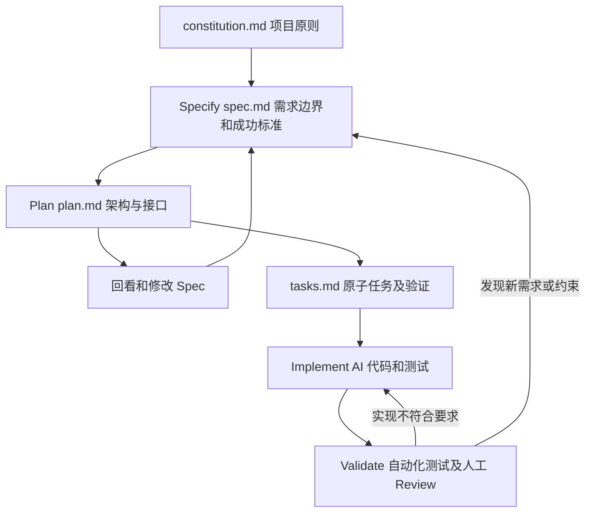

# 规格驱动AI编程

## TL;DR

本文用“5 人、7 天开发 QoderWork”的团队案例说明：并行 AI 编程的控制点在于开发前明确需求、边界、约束和验收标准。**Spec-Driven Development（SDD，规格驱动开发）**把规格说明作为唯一真实来源，代码作为派生产物，人负责 WHAT，AI 实现 HOW。执行并非一次写完大文档后线性开发，而是围绕功能模块反复进行 Specify、Plan、Implement、Validate。Spec 不能替代代码审查和测试；示例及外部统计存在依据和一致性边界，不能将作者的比较当成同一实验的因果结果。（来源：p.1–3、12–15）

## 从“AI 写得快”到“并行任务有锚点”

案例的 DAY 0 没有代码，团队定义 MVP 边界、拆模块、为每个模块写 Spec，并集中到 Repo Wiki。DAY 1–2 框架与容器同步开发，通过 Skill 和 Quest 并行推进；DAY 3–4 新需求或 BUG 转为增量 Spec，Quest 生成代码并提交 PR，人审核与合并。DAY 5–6 用 QoderWork 测试自身，即 **Dogfooding**，将发现的问题再次送入 Spec—修复循环；DAY 7 发布。作者将传统工作量描述为“20 人数周”，但没有提供逐任务对照、质量口径和工时统计，因此它是团队案例陈述，不能换算成普遍提效倍数。（来源：p.1–2）

作者强调的是共享决策：在多任务同时推进时，每个任务有明确完成条件和禁止事项。Spec 保存“为什么做、边界在哪里、成功是什么”，使这些判断可以像代码一样演变。这也解释了为什么只增加模型能力不足以保证可维护性：缺少明示约束时，模型会用上下文中的局部信息补全意图，而这种补全可能与别的模块冲突。（来源：p.2–3、10–11；后者为作者判断）

## 文件职责与闭环

以下按正文整理，来源 p.3–6、12、14，未把示例文档的并列职责误画成独立部署组件。



| 文件 | 回答的问题 | 核心内容与交接 | 来源 |
| --- | --- | --- | --- |
| `spec.md` | 做什么、为什么做 | 问题、成功指标、用户故事、验收标准、非目标、外部约束；是需求真源 | p.3–4、6 |
| `plan.md` | 如何实现 | AI 起草、人审核；架构选型、模块分解、接口契约、风险缓解 | p.4–5 |
| `tasks.md` | 如何逐项交付 | 每个原子任务对应可独立验证的交付物 | p.5 |
| `constitution.md` | 每个功能都不得违背什么 | 项目级 API、安全、质量、基础设施原则，避免每份 Spec 重复说明 | p.5–6 |

Specify 由人主导，Plan 与 Validate 由人和 AI 协作，Implement 主要交给 AI。前两阶段可以往复，后两阶段持续循环；它们的关系不能读成只能走一次的四步流水线。（来源：p.3）

### 一份需求规格应当多具体

好 Spec 的六要素各自有不可替代的职责：Problem Statement 提供动机，Success Metrics 给出结束条件，User Stories 指明使用者和场景，Acceptance Criteria 把行为变成可检查条目，Non-Goals 限制范围，Constraints 约束外部条件。（来源：p.6）

以下完整保留权限示例的需求规格，去掉原排版行号，恢复可确认的普通汉字排版；它是原文示例，非已部署系统配置。（来源：p.4）

```text
# Feature: 用户权限管理模块
## Problem Statement
当前系统缺乏细粒度的权限控制。所有用户要么是管理员（全部权限），
要么是普通用户（只读权限）。产品团队需要支持至少 5 种角色，
以满足不同部门的差异化需求。
## Success Metrics
- 支持自定义角色，每个角色可配置不少于 20 种独立权限
- 权限校验 API 响应 P95 < 50ms
- 权限变更实时生效，无需用户重新登录
- 向后兼容：现有管理员/普通用户的权限行为不变
## User Stories
1. 作为系统管理员，我可以创建自定义角色并分配权限组合
2. 作为部门主管，我可以将部门成员批量分配到指定角色
3. 作为普通用户，我的权限变更后无需重新登录即可生效
## Acceptance Criteria
- [ ] RBAC 模型支持角色继承（最多 3 层）
- [ ] 单用户可拥有多个角色，权限取并集
- [ ] 提供权限变更审计日志，保留 90 天
- [ ] 权限校验支持通配符匹配（如 `resource:*:read`）
## Non-Goals
- 本期不实现跨组织的权限委托
- 不支持基于时间段的临时权限
- 不涉及 UI 层的权限管理界面（由前端团队单独出 Spec）
## Constraints
- 必须兼容现有的 OAuth2.0 认证流程
- 权限数据存储使用现有 PostgreSQL 实例，不引入新的存储组件
- 权限模型设计需参考 AWS IAM Policy 语法规范
```

对应 Plan 采用 RBAC 和 Casbin，分为模型适配、API、缓存、审计四个模块，提供创建角色、读取权限、更新角色权限三个接口。任务拆解包括建立 `roles`、`permissions`、`role_permissions`、`user_roles` 四张表，用 `parent_role_id` 表示继承；数据库迁移在空库验证，Casbin 适配层以单测覆盖率 >90% 验证，权限 API 以压测 P95 <50ms 验证。接口详细定义及后续任务是原文主动省略，不能当成完整实现手册。（来源：p.4–5）

> [!warning] 示例约束尚未对齐
> ⚠️[原文疑点] `spec.md` 写“不引入新的存储组件”，但 `plan.md` 和 `tasks.md` 引入 Redis 缓存；原文没有交代 Redis 是否为现有基础设施。保留两种表述，不能据此认定方案已满足所有 Constraints。（来源：p.4–5）

项目原则进一步要求 RESTful、版本路径 `/api/v1/...`、RFC 7807 错误格式和 OpenAPI 3.0；安全上校验输入、敏感信息不入日志、数据库查询参数化；质量上覆盖率不低于 80%、公共方法有注释、不引入未经审计依赖；基础设施支持优雅关闭、配置从环境变量注入、日志用结构化 JSON。这里项目底线的 80% 与某个任务更严格的 >90% 是不同层级，不是数值冲突。（来源：p.5–6）

### 将歧义转成可测试的边界

“快速、相关、美观”让 AI 自行解释完成标准。搜索的好例子先说明万级文档中查找平均需 3 分钟，目标为 10 秒以内，再要求 API P95 <200ms、人工标注测试集上 Top-5 相关性准确率 >85%、中英文混合查询。其非目标明确限制为关键词匹配与分词，不做语义搜索，不搜索附件。这些数值是示例规格，不能迁移成所有搜索系统的默认要求。（来源：p.6–7）

粒度检验是“换技术栈后，这份 Spec 是否仍然有效”：指定 Redis ZSET 属于 HOW；规定排行榜实时更新、延迟 ≤1 秒、Top-100 查询属于可跨实现的 WHAT。Constraints 中可以写“必须用现有 PostgreSQL”，因为它描述外部限制。淘特团队经验是 Spec—Plan—回看 Spec 往复 3–5 轮，把开发中途才暴露的问题提前到文档修改阶段；这是一支团队的经验次数，并非硬性停止条件。（来源：p.7–8）

## 工具选择与结果证据

作者把 Spec Kit 视为通用、Agent 无关的三文件框架；OpenSpec 偏轻量对话迭代；Kiro 将工作流集成到 IDE，面向 AWS 生态；QoderWork 用 Spec 作为 Quest 任务单并行执行。选择建议来自文章写作时的产品比较，未在本笔记中核验最新版本与支持数量。（来源：p.8）

| 指标 | 原文数值 | 语境 / 条件 | 出处 |
| --- | --- | --- | --- |
| 团队交付 | 5 人、7 天；传统 20 人数周 | QoderWork 案例，未给可复算工时口径 | p.1–2 |
| Spec 迭代 | 3–5 次 | 淘特团队经验 | p.7–8 |
| 权限 API 延迟 | P95 <50ms | 示例要求与任务压测标准 | p.4–5 |
| 搜索相关性 | Top-5 >85% | 示例、基于人工标注测试集 | p.7 |
| API 变更周期 | 缩短 75% | 作者转述一篇 arXiv 金融领域实践，未给论文定位 | p.9 |
| LLM 代码错误 | 减少 50% | 作者转述人工精炼 Spec 的研究，未给实验细节 | p.9 |
| AI PR | 1300 个 | 作者转述 Stripe 的 Harness 实践 | p.9、12 |
| 安全漏洞 | 45% | 作者转述 Veracode 2025，并赋予“无 Spec”前提，文内无原报告定位 | p.9 |
| 代码重复 | 2.11 亿行研究；4 年增长 4 倍 | 作者转述 GitClear，未给详细研究出处 | p.9 |

> [!warning] 外部统计不能组成同一对照实验
> ⚠️[原文疑点] 45% 安全漏洞与“代码错误减少 50%”指向不同指标与研究，不能由二者推出 SDD 降低漏洞率的定量效果。本文也没有提供这些报告的完整定位与统一样本口径；这些数据仅保留为作者转述。（来源：p.9、11、13）

## 为什么 SDD 仍可能失败

作者用“三个月墙”描述 Vibe Coding 在增长后难维护的模式，列出 1–3 个月兴奋、4–9 个月平台、10–15 个月衰退。它是社区观察的叙事，不是普遍失效时间表。作者给出的混合策略是探索阶段快速试错，决定正式做后补 Spec，正式开发先改规格再改代码；其解释把 Spec 视为比整库源码更紧凑的全局约束表示。（来源：p.10–11）

| 错误做法 | 失败原因或表现 | 原文应对 | 来源 |
| --- | --- | --- | --- |
| 把实现细节全写死 | 退化为自然语言伪代码 | 用更换技术栈的检验区分 WHAT/HOW | p.12 |
| 代码变、Spec 不变 | 新人和 AI 基于过时规格工作 | 同步增加增量 Spec | p.12 |
| 小改动也走完整流程 | 规则太重，人开始绕过 | 跨模块行为变更用 Spec，纯局部文案样式可直接改 | p.12–13 |
| 有规格就放松 Review | Spec 定义要求，不能保证实现 | 保留 Validate 与严格 Code Review | p.13 |
| 一开始堆工具链 | 配置成本超过规格收益 | 先用一个 spec.md 和现有 Agent | p.13 |

“Markdown 版瀑布”批评是否成立取决于迭代方式。巨型 Spec 写完后长期不改，确有瀑布化风险；按单个模块写、执行、验证、继续细化，才符合作者提出的 Spec 级迭代。它不是取消反馈，而是明确反馈修改哪一层。（来源：p.13–14）

## 从上下文到 Harness，再到未来层级

**Harness Engineering** 在本文中指约束并驱动 AI 的系统框架。Prompt Engineering 关注单条指令，Context Engineering 关注足够精准的上下文，Harness Engineering 关注框架。作者将 SDD 放在后两者交叉处：constitution 为约束层，spec 为需求层，plan 为执行层，tasks 为调度层。（来源：p.11–12）

L1 **Spec-First** 是先写规格，但可能漂移；L2 **Spec-Anchored** 用 Acceptance Criteria 生成测试，再以 CI 强制检查一致性；L3 **Spec-as-Source** 是人只编辑规格、AI 生成和维护全部代码的未来愿景。作者明确 L3 尚无成熟实践，将案例增量 Spec 修复 PR 称为雏形。不能把雏形写成全面自动化已完成，也不能认为测试可以证明规格本身正确。（来源：p.14–15）

## 记忆锚点

- “先定义 WHAT，再让 AI 做 HOW。”（原文表达，p.2）
- “规格要活、验收要硬、审查要留。”（助记改写，依据 p.12–15）

## 复习卡片

SDD 的唯一真实来源是什么::需求规格 Specification，代码是派生产物；人先定义 WHAT，AI 实现 HOW。（p.2–3）
为什么 DAY 0 有控制价值::先明确 MVP、模块、边界与成功标准，让并行 Quest 都有共享锚点。（p.1–2）
spec.md 与 plan.md 怎样分工::前者写做什么与为什么，后者写架构、模块、接口与风险；Plan 可由 AI 起草、人审核。（p.3–5）
好 Spec 怎样减少解释空间::把成功写成可测试指标，同时列 Non-Goals 与 Constraints。（p.6–7）
怎样判断 Spec 是否混入 HOW::看换技术栈后是否仍成立；外部技术限制可以留在 Constraints。（p.7）
项目覆盖率 80% 与任务 >90% 是否矛盾::前者是项目底线，后者是特定任务更严格要求，两者层级不同。（p.5–6）
为什么不能用 Spec 替代 Code Review::规格仅定义要求，不能保证实现正确、安全或高效，Validate 仍包含测试和人工审查。（p.13）
L2 和 L3 的边界是什么::L2 用测试锚定规格与代码一致性，L3 是人只改规格而代码全由 AI 维护的未成熟愿景。（p.14–15）

## 知识关联

研发协同：[[AI研发协同]]、[[问题澄清]]、[[决策知识结构化]]。
工程约束与反馈：[[Harness与模型协同]]、[[Agent工程循环]]、[[Agent评测与反馈]]。

## 原文参考线索

原文提及 GitHub Spec Kit、AWS Kiro、Fission-AI OpenSpec、QoderWork、Thoughtworks 技术雷达及若干研究报告，但未提供足够的论文和报告链接。此处仅保存线索，未访问外部来源。


本次归纳主题：[AI研发协同](../../20_topics/AI研发协同.md) · [Agent工程循环](../../20_topics/Agent工程循环.md)。

> [!note]- 校对报告
> **覆盖度**：通读全部 18 个物理页文本，浏览全部页图；放大核对 p.1、4、5、9、14。正文覆盖 七天案例；SDD流程与文档；Spec写作与工具；实战数据与Vibe比较；陷阱与三级演进。推广、页尾互动与读者评论有意省略。
>
> **一致性抽查**：
>
> | 核对项 | 笔记值 | 原文值与位置 | 结果 |
> | --- | --- | --- | --- |
> | 团队案例 | 5 人、7 天 | 5 人、7 天，p.1–2 | 一致 |
> | 权限延迟 | P95 <50ms | P95 <50ms，p.4–5 | 一致 |
> | 继承层数 | 最多 3 层 | 最多 3 层，p.4 | 一致 |
> | 审计保留 | 90 天 | 90 天，p.4 | 一致 |
> | 搜索精度 | Top-5 >85% | >85%，人工标注测试集，p.7 | 一致 |
>
> **异常与边界**：权限示例禁止新存储组件但Plan和Tasks使用Redis，是否为现有组件未说明；外部统计缺完整定位，安全漏洞比例与错误减少比例不同口径，不能作统一对照；p.3 四阶段单行文本右端略裁切，四阶段表格和正文仍可确认
>
> **日期与格式**：发布日期依据 p.1 页首“王砚舒（彦纾） 阿里技术 2026年9月4日 03:08 浙江”；frontmatter 使用页首发布日期，不推测时区。本库归档名使用 `AI_规格驱动AI编程.md`，服从知识库命名规则。Mermaid 未实际渲染，文章中的命令和代码未执行；卡片按单行 `问题::答案` 保存。
