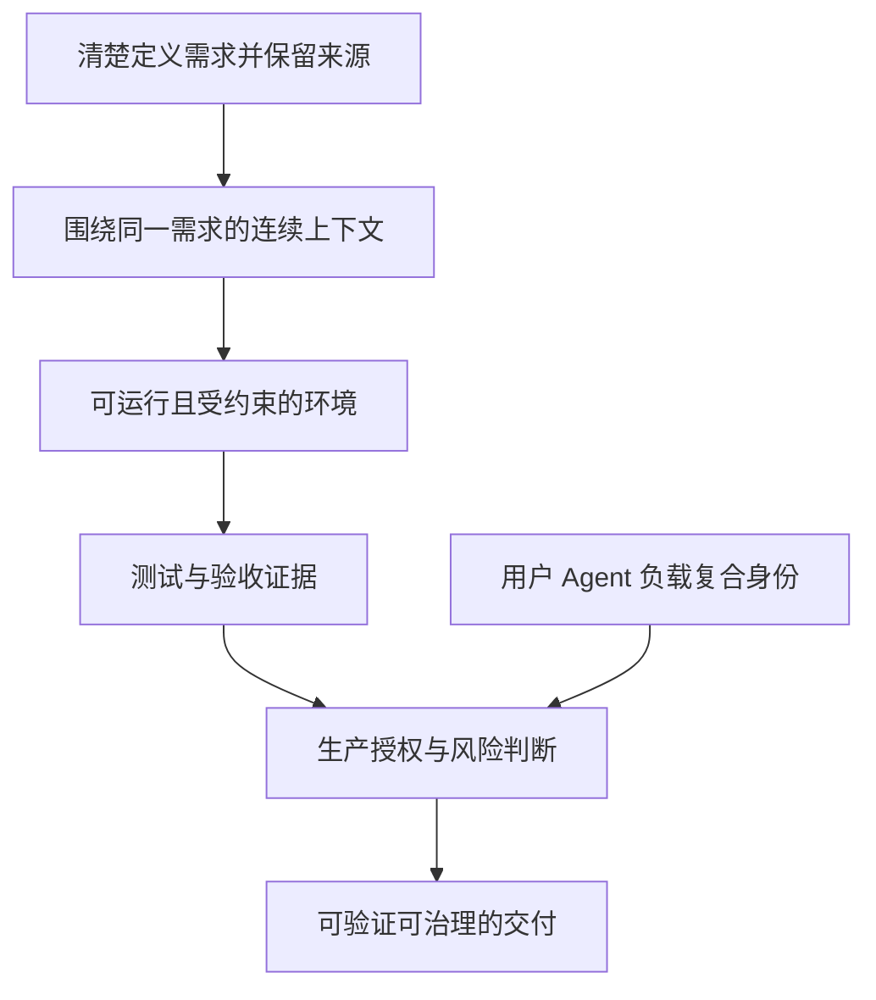
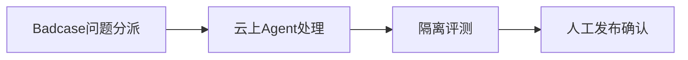

# 软件交付瓶颈与AI原生

## TL;DR

这篇论坛综述把软件交付瓶颈从代码生成转向完整链路：需求清楚、上下文连续、环境可复现、结果可验证、生产操作可治理。六位嘉宾分别讨论企业基础设施、跨角色验证、Agent驱动沙箱、需求入口、任务可驾驭性、内容生产协同，共同强调个人提速不会自动转化为团队吞吐。文中已有内部使用数据、个别业务案例和未来目标，也有明确为说明问题的假设链路；各团队口径不同，不能横向拼成统一收益排名。人继续承担任务定义、代码质量、授权、结果与风险判断。（来源：p.1–8）

## 交付速度受整条链路限制

2026年9月23日云栖AI Native研发实践论坛是本文报道对象，发布日期为9月24日。开篇的未来机器思考“1000倍以上”是演讲者展望，不是软件工程实验结果。文章明确效率、规模和业务数据来自现场分享与演示，各团队统计对象不同。（来源：p.1）

许晓斌称编码通常占阿里交付总时长20%–30%；另用编码约1小时、占比不足1%、交付约21天的极端链路说明等待成本，原文明说这个案例不是真实项目数据。陈烨用阿姆达尔定律的假设解释：若编码占一半，即使编码快100倍，整体也只接近2倍。原文没有给公式，笔记不补公式；这两个例子也不是同一组工时。（来源：p.2、5）

## 一个需求，一组事实：企业级可执行上下文

许晓斌的设计把产品文档、技术方案、设计、前后端工程、测试与验证证据围绕需求串起来。Agent缺少人的会议、聊天和经验隐含知识，需求须从一句话变成完整、精确、可运行可验证的表达，并保留来源以对比代码与初始意图。源码只是软件事实的一部分，配置、依赖、环境、数据基线、验收标准也需要可读取。（来源：p.2–3）

**Sandbox**提供可执行、受约束、可丢弃空间，应用环境复原则让Agent在接近真实系统的条件下开发和验证；工具安装、服务位置、网络边界、结果反馈必须显式化。OpenSandbox内部每周创建超过千万，另环境体系已复原约两三千应用，计划扩展一万。规划与已覆盖规模必须分开。（来源：p.2–3）

从开发到生产还要知道代表谁、可做什么：**User Identity、Agent Identity、Workload Identity**形成复合身份，关联背后用户、Agent、任务目标和实际负载，支持授权、策略、审计、高危再确认。Guardrail已有数十应用、约百人团队用于灰度/运维，半年内一半系统由Agent发布、人工最终确认是目标。（来源：p.2–3）

下面按正文整理共同建设层面，表示必要问题的并列分工，未把演讲者的不同系统画成已经互通的实现。（来源：p.2–3、8）

## Context & Verifier：把验收纳入编码循环

李英各提出 **Context & Verifier Driven Developer**。产品、设计、研发、测试在同一工作台围绕目标、上下文和证据，需求评测Agent提升PRD，研发负责架构方案约束并承担代码质量第一责任，研发与测试共同建设编码Loop里的验证，把上线验收连接成大循环。（来源：p.3–4）

团队复盘为“一个发现、一个高估、两个低估”：发现个人效率不自动变团队吞吐；高估编码提速和自由生成质量；低估跨角色沟通返工、验证复杂性。更内聚虚拟团队减少跨角色链路，工具只是其中一层，连续的信息与共同验证开始决定吞吐。（来源：p.4）

p.4现场照片中的工程资产图还能读到业务代码51.1%、约束与证明48.9%，说明演示将测试/门禁/Harness/工程文档纳入资产；图片右侧截断，未转录不可见部分。该比例是演示材料，不代表任何团队必须按此比例建设。（来源：p.4页图）

## 基础设施操作者变成Agent：隐含谨慎要变系统边界

黄挺的Badcase修复链路为问题分派→云上Agent→隔离评测→人工发布确认，阿福案例平均修复耗时降为四分之一，人工从天级到少于1小时。ARCA隔离沙箱展示200ms冷启动、8MB开销、单集群800次/秒、日均60万以上创建。（来源：p.4–5）

传统平台依赖人读提示、停在高危操作前、凭经验判断影响；Agent会围绕目标持续调用工具、改文件、触发流程。因此这些边界要变为标准接口、权限分层、隔离、限流和审计。人工仍保留发布确认，不能把平均修复收益读成全自动生产修改。（来源：p.4–5）

按p.4正文整理修复链路：

原文未给评测失败后的重试、停止或回滚细节，不自行补分支。

## AI放在需求入口：减少等待与错误起点

飞猪以领域知识库和 **PRD Gate**检查需求自洽、影响系统与资源，后续流程线上化、标准化。平台技术需求从评审到上线平均2–4周降至1周；超过三成业务需求由AI流程支撑，住宿超60%应用接入，商旅组件生产效率超70%提升。它们指不同业务对象，不能当成一条相同分母的进度曲线。（来源：p.5）

陈烨区分Copilot辅助、Agent主导执行、AI Native作为团队成员重设计流程。人在任务定义、结果判断和风险决策；他概括新的瓶颈为搞清做什么、判断结果、写下知识，并把AI Native视为组织选择。（来源：p.6）

## 可驾驭性为不同任务划界

彭鑫提出**可驾驭性**的三问：任务能否清楚定义，结果能否客观验证，环境能否被Agent理解、导航和操控。一次性方案、明确工具流程、长期复杂系统要求不同，组织重构并不意味所有任务都适合AI。复杂系统还需持续记录需求、架构、决策、演化历史，形成与代码对应的“数字孪生”。文章在此给的是判断框架，未展开数字孪生实现。（来源：p.6–7）

## 内容生产同样暴露组织问题

李亚洲称机器之心论文报道过去两编辑一上午做翻译、整合、校对、排版发布，现在一编辑一个多小时；工作量约增到三倍是现场估计。不同编辑仍用不同工具和Prompt，统一工作流尚未形成。这支持文章关于个人产出与团队流程不同的观察，但没有给缺陷率、审核成本或长期质量对照。（来源：p.7–8）

## 数据速查与证据性质

| 指标 | 原文数值 | 语境 / 条件 | 出处 |
| --- | --- | --- | --- |
| 编码时长占比 | 20%–30% | 许晓斌所述阿里通常情况 | p.2 |
| 极端链路 | 编码约1小时、<1%；交付约21天 | 说明例子，非真实项目数据 | p.2 |
| OpenSandbox创建 | 每周超过千万 | 内部运行、训练、评测 | p.2 |
| 应用环境复原 | 约两三千；计划一万 | 已覆盖与未来扩展分开 | p.2 |
| Agent发布 | 半年内一半生产系统 | 目标；人工最终确认 | p.2 |
| 阿福Badcase | 修复耗时为原1/4；人工<1小时 | 现场业务案例 | p.4 |
| ARCA冷启动/开销 | 200ms /8MB | 沙箱现场披露 | p.4 |
| ARCA吞吐/日量 | 单集群800次/秒；日均60万以上 | 沙箱现场披露 | p.4 |
| 飞猪交付周期 | 2–4周→1周 | 平台技术评审到上线平均 | p.5 |
| 飞猪接入范围 | >30%平台需求、>60%住宿应用 | 不同业务分母 | p.5 |
| 商旅组件效率 | 提升>70% | 业务组件生产 | p.5 |
| 假设整体效率 | 编码占50%、快100倍，整体近2倍 | 阿姆达尔解释示例，非实测 | p.5 |
| 编辑部工作量 | 约3倍 | 李亚洲现场估计 | p.7 |

原文没有统一基线、样本量、观测窗口和复现实验，数据均应带嘉宾和语境，不作为跨组织排名。软件交付需要上下文、测试、沙箱、身份权限一起变化，人/Agent的责任也同步调整。（来源：p.1、8）

## 记忆锚点

- “一个需求，一组事实。”（许晓斌表达，p.3）
- “搞清做什么、判断结果、把知识写下来。”（陈烨观点，p.6）

## 复习卡片

编码更快为什么不必然交付更快::编码只占部分链路，影响分析环境联调审批灰度等等待会成为瓶颈。（p.2、5）
一个需求一组事实包含什么::PRD方案设计代码测试证据，以及配置依赖环境基线验收，围绕同一目标连续组织。（p.2–3）
复合身份关联哪三类身份::User、Agent、Workload，用于授权策略审计及高危再确认，并关联用户任务和实际负载。（p.3）
研发在Context&Verifier框架中承担什么责任::架构方案约束与代码质量第一责任，并与测试完善编码循环的验证。（p.3–4）
Agent操作者为何要求系统化边界::它持续执行，不能依赖人的经验谨慎，需标准接口权限隔离限流审计。（p.5）
可驾驭性的三问是什么::任务是否清楚、结果是否客观验证、环境是否可理解导航操控。（p.7）
编码1小时交付21天是什么证据::是说明极端链路的假设例子，原文明确非真实项目数据。（p.2）
半年内半数Agent发布是否已完成::是未来目标，目前Guardrail在数十应用约百人团队使用。（p.2）

## 知识关联

交付与组织：[[AI研发协同]]、[[问题澄清]]、[[决策知识结构化]]。
系统与证据：[[Harness与模型协同]]、[[Agent评测与反馈]]、[[Agent工程循环]]。

## 原文参考入口

原文p.8给出[AI Native研发手册](https://ai-native.alistatic.com/app/ainativeinfra/ai-native-handbook-web/index)，未访问核验；本笔记只覆盖论坛综述PDF。

本次归纳主题：[AI研发协同](../../20_topics/AI研发协同.md)。

> [!note]- 校对报告
> **覆盖度**：通读全部 10 个物理页文本，浏览全部页图；放大核对 p.1、2、4、5、7。正文覆盖 论坛与统计边界；企业基础设施与事实；上下文验证与沙箱；需求入口与组织；可驾驭性与内容生产。推广、页尾互动与读者评论有意省略。
>
> **一致性抽查**：
>
> | 核对项 | 笔记值 | 原文值与位置 | 结果 |
> | --- | --- | --- | --- |
> | 编码占比 | 20%–30% | p.2 | 一致 |
> | ARCA冷启动 | 200ms | p.4 | 一致 |
> | ARCA内存 | 8MB | p.4 | 一致 |
> | ARCA吞吐 | 800次/秒 | 单集群，p.4 | 一致 |
> | 飞猪周期 | 2–4周→1周 | p.5评审到上线平均 | 一致 |
>
> **异常与边界**：各团队数据来自现场分享，统计对象不同，不直接横向比较；编码1小时/交付21天案例原文明示非真实项目数据；p.4现场演示右侧内容被照片构图截断，未补不可见部分
>
> **日期与格式**：发布日期依据 p.1署名“机器之心 阿里技术 2026年9月24日 03:02 浙江”；仅按实际署名记录来源，不推个人作者；frontmatter 使用页首发布日期，不推测时区。本库归档名使用 `AI_软件交付瓶颈与AI原生.md`，服从知识库命名规则。Mermaid 未实际渲染，文章中的命令和代码未执行；卡片按单行 `问题::答案` 保存。
